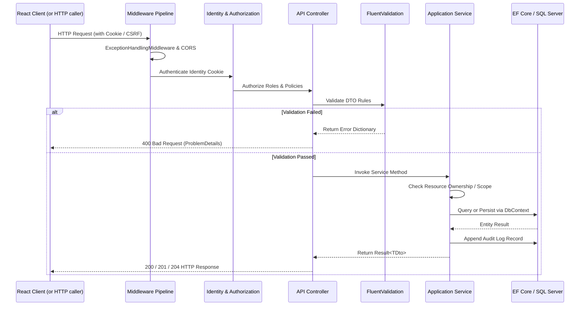

# Architecture and Technical Design

This document details the architectural principles, layer responsibilities, design patterns, and request lifecycle governing the **AcxiomCRM** backend.

---

## 1. Architectural Style: Clean Architecture Modular Monolith

AcxiomCRM is structured as a modular monolith adhering to Clean Architecture principles. Business domain models and rules are entirely independent of external frameworks, user interfaces, and persistence concerns.

```
       [ AcxiomCRM.Api ]                <- Presentation & Web Hosting
              |
              v
     [ AcxiomCRM.Application ]          <- Use Cases, DTOs, Validations, Orchestration
        ^                 ^
        |                 |
 [ AcxiomCRM.Infrastructure ]          <- EF Core, Identity, SQL Server, Auditing
        |
        v
       [ AcxiomCRM.Domain ]             <- Entities, Value Objects, Enums, Constants
```

### Layer Responsibilities

| Layer | Project | Responsibilities & Boundaries |
|---|---|---|
| **Domain** | `AcxiomCRM.Domain` | Pure domain entities (`Customer`, `Lead`, `Opportunity`, etc.), business enums, and static constants (e.g. `Roles`). Zero dependencies on EF Core or web frameworks. |
| **Application** | `AcxiomCRM.Application` | Use cases, DTOs, interfaces (`ICustomerService`, `IAuditService`), FluentValidation rules, pagination abstractions, and business exceptions (`NotFoundException`, `ConflictException`). Independent of React, HTTP, or controllers. |
| **Infrastructure** | `AcxiomCRM.Infrastructure` | Data access with EF Core, Identity setup (`ApplicationUser`), SQL Server entity configurations, migrations, database seeding, and auditing implementations. |
| **Presentation** | `AcxiomCRM.Api` | Thin controllers, middleware (`ExceptionHandlingMiddleware`), anti-forgery configuration, CORS policy definition, Dependency Injection root, and OpenAPI/Swagger specification. |

---

## 2. Request Lifecycle

Every HTTP request traverses a standardized lifecycle:



---

## 3. Security & Authorization Model

### Identity Management
- Implemented using **ASP.NET Core Identity** backed by SQL Server.
- Passwords are encrypted using Identity's PBKDF2 algorithm with HMAC-SHA256.
- Strict password policy: Minimum 8 characters, requiring uppercase, lowercase, numbers, and symbols.
- Lockout policy: 5 consecutive failed attempts trigger a 15-minute lockout.

### Business Roles
The CRM defines three roles centrally in `AcxiomCRM.Domain.Constants.Roles`:
1. `Admin`: Unrestricted access to all CRM records, reports, audit logs, and user management.
2. `Manager`: Access to all team CRM records, pipeline metrics, and management reports.
3. `SalesExecutive`: Restricted strictly to CRM records assigned to their user ID or created by them. Direct query tampering with foreign entity IDs is blocked at the service layer and returns `403 Forbidden`.

---

## 4. Error Handling and Problem Details

The API utilizes standard **RFC 7807 Problem Details** for all error scenarios:
- **Validation Errors (`400 Bad Request`)**: Returns `errors` object mapping field names to an array of error messages.
- **Unauthorized (`401 Unauthorized`)**: Cookie redirects are converted to explicit 401 status codes.
- **Forbidden (`403 Forbidden`)**: Raised when a user attempts to access an unauthorized record.
- **Resource Missing (`404 Not Found`)**: Raised via `NotFoundException`.
- **Conflicts (`409 Conflict`)**: Raised on duplicate codes or email collisions.
- **Unhandled (`500 Internal Server Error`)**: Sanitized message presented to caller; stack traces logged securely to server logs.
