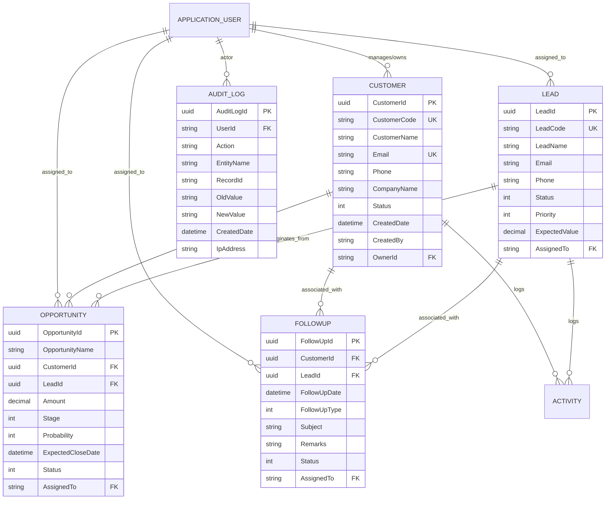

# Database Schema & Entity Relationships

This document outlines the database design, tables, constraints, foreign keys, indexes, and migration guidelines for **AcxiomCRM**.

---

## 1. Entity-Relationship Diagram



---

## 2. Table Specifications & Indexes

### Table: `Customers`
- Primary Key: `CustomerId` (Uniqueidentifier)
- Indexes:
  - Unique Index on `CustomerCode`
  - Unique Index on `Email`
  - B-Tree Index on `OwnerId` (Optimizes scoped queries for sales reps)
  - B-Tree Index on `Status`

### Table: `Leads`
- Primary Key: `LeadId` (Uniqueidentifier)
- Indexes:
  - Unique Index on `LeadCode`
  - B-Tree Index on `AssignedTo`
  - B-Tree Index on `Status`

### Table: `Opportunities`
- Primary Key: `OpportunityId` (Uniqueidentifier)
- Foreign Keys:
  - `CustomerId` references `Customers(CustomerId)` (DeleteBehavior: Restrict)
  - `LeadId` references `Leads(LeadId)` (DeleteBehavior: SetNull)
- Indexes:
  - B-Tree Index on `CustomerId`
  - B-Tree Index on `AssignedTo`
  - B-Tree Index on `Stage`

### Table: `FollowUps`
- Primary Key: `FollowUpId` (Uniqueidentifier)
- Foreign Keys:
  - `CustomerId` references `Customers(CustomerId)` (DeleteBehavior: Cascade)
  - `LeadId` references `Leads(LeadId)` (DeleteBehavior: Cascade)
- Indexes:
  - B-Tree Index on `FollowUpDate`
  - B-Tree Index on `AssignedTo`
  - B-Tree Index on `Status`

### Table: `AuditLogs`
- Primary Key: `AuditLogId` (Uniqueidentifier)
- Indexes:
  - B-Tree Index on `CreatedDate` (Desc for fast chronological queries)
  - B-Tree Index on `UserId`
  - B-Tree Index on `EntityName`

---

## 3. Database Migration Procedures

EF Core tools manage schema generation and updates.

### Adding a new migration
```bash
dotnet ef migrations add <MigrationName> \
  --project src/AcxiomCRM.Infrastructure \
  --startup-project src/AcxiomCRM.Api
```

### Applying migrations to SQL Server
```bash
dotnet ef database update \
  --project src/AcxiomCRM.Infrastructure \
  --startup-project src/AcxiomCRM.Api
```

### Generating SQL Script for Production
```bash
dotnet ef migrations script \
  --project src/AcxiomCRM.Infrastructure \
  --startup-project src/AcxiomCRM.Api \
  --idempotent \
  --output migrations.sql
```
